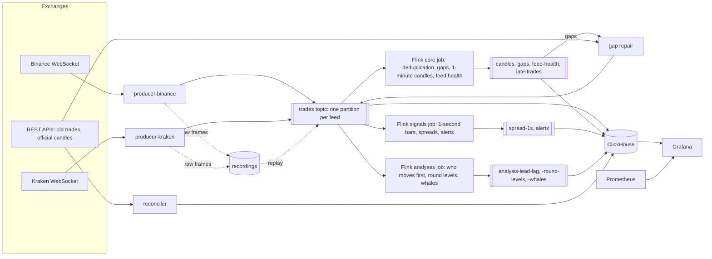

# Tick Lab

A live monitor for crypto trades, built to learn stream processing properly.

Trades from Binance and Kraken flow through Python producers into Redpanda, are processed by
Flink, stored in ClickHouse and shown in Grafana. Every number the pipeline produces is checked
against the exchanges' own figures.

**Status:** work in progress. Milestones 1 to 8 are done:

- live Binance trades are normalised, published as Avro, stored in ClickHouse, recorded raw,
  and can be replayed exactly;
- Flink removes duplicates and builds 1-minute candles in event time;
- a reconciler compares every settled minute with Binance's official candles, field by field;
- gaps in trade IDs are found in Flink and filled from Binance's REST API, and feeds that go
  quiet are reported;
- an end-to-end test replays a fixture with injected chaos (reordering, delays, repeats and
  missing trades) through a throwaway stack, in CI;
- Kraken's trades come in alongside Binance's, are reconciled against Kraken's own candles, and
  its gaps are filled from its REST API, which pages by time rather than by trade ID;
- a second Flink job compares BTC, ETH and SOL on both exchanges every second, converting
  Kraken's US dollar prices to USDT at the USDT/USD price of the moment (Flink SQL with temporal
  joins), and raises alerts for divergences, price moves and volume spikes;
- the busiest hour of the history, replayed at 1, 10 and 100 times real time on a 2-core and a
  4-core machine, measures throughput, consumer lag and latency, which a "Pipeline" dashboard
  also shows live;
- a third Flink job finds sharp 1-second price moves on each exchange and pairs them across the
  two, to see which exchange moves first;
- the same job tests whether prices turn back at round numbers, against random levels as a
  control, and follows the price for two minutes after each very large taker order.

## How it fits together



Producers normalise each exchange's trades into one Avro schema, one Kafka partition per feed.
Three Flink jobs read every trade: the core job removes duplicates, finds gaps (which gap repair
fills from the exchange's REST API) and builds 1-minute candles; the signals job compares the
two exchanges every second; the analyses job finds price moves on each exchange and pairs them
across the two, tests price levels, and follows the price after very large orders. ClickHouse
stores everything, idempotently, and the reconciler checks every minute against the exchange's
own candles.

## Results

### Correctness

In the milestone 2 check, all 120 live minutes on each of the three pairs, and all 4,320
minutes of a replayed day of history, matched exactly. In the milestone 3 check, the Flink
TaskManager was killed, the producer restarted and its internet cut for 60 s; every minute
around those failures still matched (64 on each pair), and all 9 gaps they left were filled
within a second of being found.

In the milestone 4 check, all 120 live minutes matched on all seven feeds of both exchanges,
through a TaskManager kill and a restart and a network cut of each producer. Kraken's past 24
hours, replayed, matched all 2,852 minutes it still publishes. A day of both exchanges, replayed
twice, gave the same 152,691 spreads and 23 alerts both times, each spread equal to a
plain-Python recomputation from the same history.

### Throughput and latency

The benchmark replays the busiest hour of the history (2026-10-08 15:00 to 16:00 UTC, 1,362,042
trades from both exchanges) at 1, 10 and 100 times real time, into an empty stack running the
core and signals jobs, the two there were in milestone 5 (`make bench`, decision note 0019).
Every run's results, checkpoints and memory included, are in [bench/results/](bench/results/).

| Profile | Speed | Trades a second | Largest consumer lag, core / signals | Trade pipeline latency, p50 / p99 | Candle output latency, p50 / p99 |
|---|---:|---:|---:|---:|---:|
| lite (2 cores, 8 GB) | 1× | 378 | 0 / 0 | 2.6 s / 5.1 s | 4.6 s / 15.3 s |
| lite (2 cores, 8 GB) | 10× | 3,783 | 0 / 0 | 2.8 s / 5.7 s | 0.6 s / 2.2 s |
| lite (2 cores, 8 GB) | 100× | 37,826 | 664,222 / 429,723 | 15.4 s / 22.3 s | 28.7 s / 38.0 s |
| full (4 cores, 16 GB) | 1× | 378 | 0 / 0 | 2.6 s / 5.1 s | 4.6 s / 15.4 s |
| full (4 cores, 16 GB) | 10× | 3,784 | 0 / 0 | 2.7 s / 5.4 s | 0.6 s / 2.1 s |
| full (4 cores, 16 GB) | 100× | 37,830 | 11,053 / 18,667 | 3.7 s / 6.9 s | 0.4 s / 4.5 s |

- **The lite profile keeps up with ten times the busiest hour,** 3,783 trades a second, with no
  lag at all. At 100 times, Kafka still took every trade on schedule, but the Flink jobs fell up
  to 664,000 trades behind, and the end of the replay took 75 s to drain and settle instead of
  27 s. The full profile kept up even at 100 times, never more than 19,000 trades (half a
  second) behind. It has twice the cores and memory and runs the jobs at parallelism 2, so these
  runs don't say which of those mattered.
- **Pipeline latency is ClickHouse's batching,** not processing: ClickHouse reads `trades` from
  Kafka in blocks flushed at most every 5 s, so a trade waits 2.6 s in the median at any speed
  the stack keeps up with.
- **Candle output latency is the watermark's.** A minute's candles come out once the watermark
  passes the minute's end, and the watermark is the minimum over all seven feeds. In a replay,
  where idleness is off, that means waiting for the quietest feed's next trade: 4.6 s in the
  median at 1×, 0.6 s at 10×, where the same wait in trade time passes ten times faster.
- **Checkpoints stay small and quick:** at most 1.5 s and 1.2 MB (the signals job, lite at
  100×), because the state is a few open windows and the latest prices.

Live, on the lite profile over 7 quiet minutes (2026-10-11 22:08 to 22:15 UTC: 22,917 trades and
49 candles):

| Latency | Binance, p50 / p99 | Kraken, p50 / p99 |
|---|---|---|
| Feed: received by our producer minus the exchange's trade time | 89 / 326 ms | −23 / 28 ms |
| Pipeline: stored in ClickHouse minus published to Kafka | 2.2 / 5.1 s | 2.3 / 5.1 s |
| Candle output: emitted minus the publishing of its newest trade | 8.5 / 15.7 s | 10.6 / 21.0 s |

Live, idleness is on: a quiet feed holds the watermark back until it has been silent for 10 s,
so candles come out about 10 s after their minute, and a quiet feed's output latency also counts
the rest of the minute after its last trade. Kraken's feed latency is negative because its clock
was ahead of this machine's.

### Who moves first

A week of both exchanges (2026-10-04 to 10, 40 million trades), replayed through the analyses job
(`make check-m6`). A move is a second whose close is more than a threshold away from the one
before (BTC 5, ETH 7, SOL 9 bps: Binance's 99.9th percentile of 1-second moves), timed by its
first trade beyond the threshold. Moves of the two exchanges in the same direction within 2 s
are paired, and the earlier one leads (decision note 0020). Every row the job produced equals a
plain-Python recomputation from the same history.

| Base | Pairs | Binance first | 95% interval | Median lead, Binance first | Kraken first | Moves not followed, Binance / Kraken |
|---|---:|---:|---:|---:|---:|---:|
| BTC | 120 | 79% | 71% to 85% | 263 ms | 473 ms | 156 / 138 |
| ETH | 194 | 84% | 78% to 88% | 271 ms | 584 ms | 173 / 232 |
| SOL | 128 | 88% | 81% to 92% | 250 ms | 239 ms | 133 / 204 |

Binance moved first in four pairs out of five, about a quarter of a second ahead, and the
pattern holds for every threshold from 2 to 20 bps (docs/data-study.md). More than half of all
moves weren't matched by the other exchange within 2 s at all.

### Round-number magnets

Four weeks of Binance (2026-09-12 to 10-10), by the definitions that `make check-m7` proves equal
to the job's on two busy days. A test starts when the price reaches a level from beyond its band
(the pair's median one-minute move: BTC 16.50, ETH 0.77, SOL 0.05 USDT). The close 60 s later
decides it: a band past the level is a break, a band back a bounce, anything between neutral.
Random levels, one in each step and nowhere special, are the control (decision note 0021).

| Pair | Tier | Round levels: tests | Bounce share of decided | Random levels: tests | Bounce share of decided |
|---|---|---:|---:|---:|---:|
| BTC | major (every 1,000) | 1,135 | 42.4% (39.0% to 45.9%) | 954 | 41.9% (38.1% to 45.8%) |
| BTC | minor (every 100) | 11,196 | 38.8% (37.7% to 39.9%) | 11,112 | 39.2% (38.1% to 40.3%) |
| ETH | major (every 100) | 521 | 47.2% (41.8% to 52.7%) | 444 | 43.4% (37.9% to 49.1%) |
| ETH | minor (every 10) | 5,017 | 45.4% (43.6% to 47.1%) | 4,890 | 43.1% (41.4% to 44.8%) |
| SOL | major (every 10) | 428 | 46.6% (40.3% to 53.0%) | 164 | 50.9% (41.8% to 59.9%) |
| SOL | minor (every 1) | 3,153 | 47.5% (45.2% to 49.8%) | 2,815 | 48.8% (46.5% to 51.1%) |

95% intervals in brackets. Round numbers turned prices back no more often than random levels:
in every pair and tier the two intervals overlap. Prices tend to go on through any level they
have just reached: decided tests bounced 39% to 51% of the time, not half.

### Whale aftershocks

Four weeks of Binance (2026-09-12 to 10-10), by the definitions that `make check-m8` proves
equal to the job's on two busy days. A whale is a taker order (its fills grouped back together)
worth more than the 99.9th percentile of the pair's orders in the hour before it. Its move at
each horizon is the last price then against the whale's own average price, signed so that
positive means the price went on the way the whale pushed it (decision note 0022).

| Pair | Whales | Move after 10 s | 30 s | 60 s | 120 s | Reverted after 10 s | 120 s |
|---|---:|---:|---:|---:|---:|---:|---:|
| BTC | 15,654 | +0.87 bps (+0.80 to +0.93) | +0.89 | +0.84 | +0.82 (+0.64 to +0.99) | 32% | 45% |
| ETH | 10,814 | +0.81 bps (+0.68 to +0.94) | +0.77 | +0.63 | +0.49 (+0.18 to +0.79) | 41% | 46% |
| SOL | 5,930 | +1.21 bps (+1.03 to +1.39) | +1.36 | +1.40 | +1.21 (+0.74 to +1.69) | 43% | 47% |

Average moves with 95% intervals in brackets. Whales were not reversed on average: the price
stayed about 1 bp further in the whale's direction for the whole two minutes. More of them had
reverted the longer one waited, but fewer than half even at 120 s.

## Limitations

- **One machine, one hour.** The benchmarks describe a GitHub codespace replaying one busy hour
  of one week. They are a baseline to compare changes against, not a capacity claim.
- **Two clocks.** Feed latency subtracts an exchange's timestamp from our clock, so it includes
  the offset between them, which changes with the machine: Kraken's median was 0.3 s in one
  session and −23 ms in another.
- **Leads are measured on the exchanges' clocks.** A difference between Binance's and Kraken's
  clocks would look exactly like a lead, and Kraken, which trades far less often, can show a
  move only at its next trade. The leads are evidence of where prices move first, not proof.
- **Round levels and whales cover Binance only.** They rely on prices in whole cents, and on
  the fills of one taker order sharing a time and consecutive trade IDs; Kraken would need rules
  of its own.
- **One watermark per job.** A minute's candles wait for the quietest of the seven feeds: live,
  until it trades past the minute or has been silent for 10 s. A busy pair's candle can wait on
  a quiet one.
- **Downtime leaves holes.** A repaired trade still reaches its candle only within the 5-minute
  lateness budget, so an outage longer than that leaves minutes without candles; their trades
  are stored all the same, and listed in `late_trades`. Gaps of more than 50,000 trades, such as
  the stack being stopped for hours, are reported as failed and not fetched at all.
- **Spreads are a live signal.** The 1-second bars drop trades that come later than the
  watermark, such as repaired ones; candles, which accept late trades for 5 minutes, are the
  exact record.
- **No high availability.** One broker, one JobManager, one ClickHouse. Flink recovers from a
  TaskManager crash by itself, from its last checkpoint. A JobManager crash stops the jobs, and
  `make up` restarts them from Kafka's committed offsets but without their state, so the
  candles of the minute in progress come out incomplete.

## Running it

Needs Docker with Compose, GNU Make and [uv](https://docs.astral.sh/uv/). It is developed on a
machine with 2 cores and 8 GB of RAM (a GitHub codespace on the default image).

```sh
make up        # live stack: Binance, Kraken -> producers -> Redpanda -> Flink -> ClickHouse, Grafana
make ps        # containers and their health
make down      # stop; Flink saves its state first, and `make up` resumes from it
```

Grafana is on http://localhost:3000 (dashboards "Feed health", "Correctness", "Market",
"Pipeline" and "Analyses"), the Flink web UI on :8081, Prometheus on :9090 and ClickHouse's HTTP
interface on :8123. All ports are bound to 127.0.0.1.

Other targets (`make help` lists them all):

| Target | What it does |
|---|---|
| `make record [EXCHANGE=kraken]` | Records live frames without Docker or Kafka |
| `make history FROM=2026-10-09` | Downloads Binance's daily trade files and checks them |
| `make kraken-history FROM=… TO=…` | Downloads Kraken's trades for a time range and checks them |
| `make replay-up [JOBS=analyses]`, `make replay FROM=… TO=…` | Replays recordings into a separate, empty stack |
| `make replay-history FROM=…`, `make replay-kraken-history FROM=… TO=…` | Replays history the same way |
| `make replay-drain` | Ends a replay: every remaining window fires |
| `make reconcile FROM=… TO=…` | Compares candles with the exchanges' official ones, minute by minute |
| `make study-signals FROM=… TO=…` | The distributions behind the alert thresholds |
| `make study-lead-lag FROM=… TO=…` | The 1-second moves behind the lead-lag thresholds |
| `make study-round-levels FROM=… TO=…` | The 60-second moves behind the round-level bands |
| `make bench SPEED=10 PROFILE=lite` | Replays the busiest hour at 1, 10 or 100 times real time and measures it |
| `make e2e`, `make e2e-kraken`, `make chaos SEED=11` | The end-to-end tests: a fixture with chaos through a throwaway stack |
| `make fail-taskmanager`, `fail-producer`, `fail-network` [`PRODUCER=kraken`] | Failures to inject into the live stack |
| `make ci` | Lint, Python and Java tests and the end-to-end test, as GitHub Actions runs them |
| `make check-m1` … `make check-m8` | Each milestone's checks, with their evidence |

Settings live in `.env`, created from `.env.example` on first use. Nothing in it is secret.

## Learning

[LEARNING.md](LEARNING.md) explains each streaming concept as it appears in the code, and
[docs/decisions/](docs/decisions/) records why things are built the way they are.
